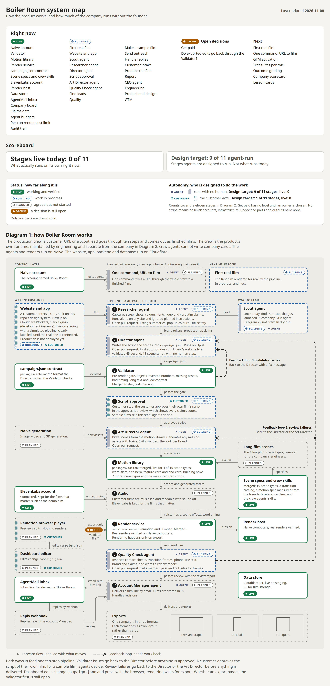
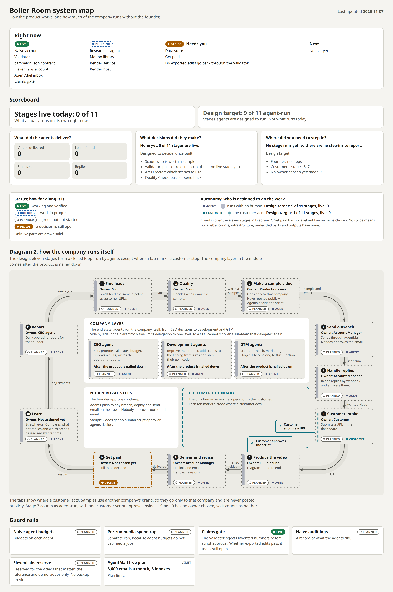

# Boiler Room system map

One page that shows how Boiler Room works and how much of the company runs without the founder. Open [`index.html`](index.html) by double-clicking it; it needs no server or install.

The page holds both diagrams, the scoreboard, the human boundary and the guard rails. It answers the three questions the judges ask: what did the agents deliver, what decisions did they make, and where did you need to step in?

Most of this is the design, not what runs today. The scoreboard keeps those two apart: "Agent-run stages" is the target, "Stages live today" is the real number.

## Diagram 1: how Boiler Room works

Both ways in feed one ten-step pipeline. The heavy dashed arrows are the two feedback loops.



## Diagram 2: how the company runs itself

Eleven stages form a closed loop around the human boundary. Every tab that crosses the dashed line is a place a person steps in. This image also carries the scoreboard and the guard rails.



## Vocabulary

Every part has a status, shown by its border and a labelled chip.

| Status | Meaning | Border |
| --- | --- | --- |
| `live` | Working and verified | Solid |
| `building` | Work in progress | Dashed |
| `planned` | Agreed but not started | Dotted |
| `decide` | A decision is still open | Dash and dot |

Every part also has an autonomy level, shown by its left stripe. Stages and agents also show it as a labelled chip.

| Autonomy | Meaning | Stripe |
| --- | --- | --- |
| `agent` | Runs with no human | Solid |
| `approval` | Agent does the work, a human approves | Hatched |
| `customer` | The customer acts | Dotted |
| `human` | A person does it | Crossed |

Mark something `live` only once it is working and verified. A connected account is not a working step: the ElevenLabs account is live while the Audio step is still planned.

## Update the map

Everything you need to change is in the `MAP` object at the top of the script in `index.html`.

1. Change the word. For example, when the Validator is merged and verified, change its `status` from `'building'` to `'live'`.
2. Update `lastUpdated`.
3. Reload the page. Borders, chips, the key and the scoreboard all follow from the data.
4. [Regenerate the images](#regenerate-the-images) so GitHub shows the same thing.

| To change | Edit in `MAP` |
| --- | --- |
| A status or autonomy level | That node's `status` or `autonomy` |
| Real results (videos, leads, emails, replies) | `counters` |
| Where a person steps in | That stage's `person`. Leave it out and the tab disappears. |
| The Naive balance, ElevenLabs credits or plan limits | `guardRails` |

Colours are CSS variables on `:root` at the top of the page, with a dark set below them. When the brand is chosen, swap those and nothing else.

To add a node, draw a `<g data-node="your-id">` in the SVG and add an entry with the same `id` to the data. If the data and the drawings stop matching, or a word is misspelled, the page shows a warning at the top and `render.mjs` refuses to run.

## Regenerate the images

`render.mjs` captures `technical.png` and `autonomy.png` from the page at 2x scale, always in the light theme. It needs Playwright, which stays outside the repo:

```bash
TOOLS=/tmp/system-map-tools
npm install --prefix "$TOOLS" playwright
"$TOOLS/node_modules/.bin/playwright" install chromium
PLAYWRIGHT_DIR="$TOOLS" node docs/system-map/render.mjs
```

After the first time, you only need the `TOOLS=` line and the last line.
