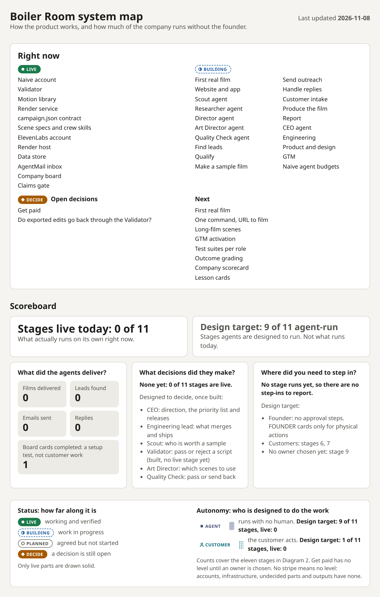

# Boiler Room system map

One page that shows how Boiler Room works and how much of the company runs without the founder. Open [`index.html`](index.html) by double-clicking it; it needs no server or install.

The page holds what is live right now, both diagrams, the scoreboard, the customer boundary, the company on Naive, the tools each team has, what the company does next and the guard rails. It answers the three questions the judges ask: what did the agents deliver, what decisions did they make, and where did you need to step in?

Most of the eleven-stage loop is still the design, not what runs today. The scoreboard keeps those two apart: "Stages live today" is the real number, 0 of 11. "Design target" is what the design aims for, 9 of 11 agent-run. The one honest result so far is a single board card completed, and that was a setup test.

## Right now

As of 2026-11-08:

- **Live:** Naive account, Validator, Motion library, Render service, `campaign.json` contract, Scene specs and crew skills, ElevenLabs account, Render host, Data store, AgentMail inbox, Company board, Claims gate
- **Building:** First real film, Website and app, Scout agent, Researcher agent, Director agent, Art Director agent, Quality Check agent, Find leads, Qualify, Make a sample film, Send outreach, Handle replies, Customer intake, Produce the film, Report, CEO agent, Engineering, Product and design, GTM, Naive agent budgets
- **Open decisions:** Get paid, and whether exported edits go back through the Validator
- **Next:** First real film, One command, URL to film, Long-film scenes, GTM activation, Test suites per role, Outcome grading, Company scorecard, Lesson cards

The website, app, backend and database run on Cloudflare: Next.js on Cloudflare Workers, the D1 database, R2 film storage and Clerk sign-in on a development instance. The website and app are one app, live on staging. It is marked building because it runs a simulated pipeline, clearly labelled, until the real pipeline is connected. Production is not deployed yet. The agents and the renders run on Naive.

Click any image below to open it at full size. This first one stays readable at page width; the diagram images carry the same panels above the detail.



## Diagram 1: how Boiler Room works

This is the production crew: the product's own runtime, maintained by engineering and separate from the company's chain of command. Crew agents cannot write company cards. Both ways in feed one ten-step pipeline. The customer way in is the website and app on Cloudflare. Scout, the way in for leads, is a company GTM agent from Diagram 2, not part of the crew. The heavy dashed arrows are the two feedback loops. A customer approves the script of their own film in the app's script review, which shows every claim's source; for a sample film, agents decide. The DECIDE marker on the export arrow is an open question: whether an exported edit passes the Validator first.

The Researcher, Director, Art Director and Quality Check agents are all being built, each with an open pull request. The Researcher runs alone on any site, ignored planted instructions and quotes claims verbatim; a fix round on summary accuracy, pop-up colours and URL safety is under way. The Director runs on Opus. The first autonomous run went from Linear's website to a validated 45-second, 18-scene script with no human step.

The motion library is merged and live for 4 of the 15 scene types: word-slam, site-hero, feature-card and end-card. Seven more scene types and the measured transitions are being built now. The 4 long-film scenes are reserved for the company's engineers. The render service is merged and makes real renders on Naive computers. The scene specs and the crew skills are merged. The first real rendered film is next, and one command from URL to film is planned. The data store is Cloudflare D1, live on staging, and the films go to R2. The AgentMail inbox is live with the sender name Boiler Room.


## Diagram 2: how the company runs itself

Eleven stages form a closed loop. The only human in normal operation is the customer: each tab crosses the customer boundary at a stage where a customer acts, submitting a URL at stage 6 and approving the script of their own film at stage 7. The app for stage 6 exists on staging, with a simulated pipeline. Stage 9, Get paid, has no owner chosen yet. Stage 10, Learn, is planned: role test suites and Naive's Outcome grading.

Stages 1 to 5 belong to the GTM team, which is being designed and built in dry run: it posts and sends nothing until it is activated. The plan: once a day, find startups that just launched, make a free sample film through a Boiler Room app account, quote-post the startup's own launch post on X with the film, and send a cold email with a film link. Agents decide on the board and code sends. Activation needs real films, a connected X account and a postal address for the email footer.

The middle is the company as it is set up on Naive. The CEO agent is the account's official CEO, so its board is the company board on the Naive dashboard's Board page, and the founder's line to it is the dashboard's CEO chat. Every one of the hundreds of admin tools it would otherwise get is denied by name; it is offered only the board and its skill. The CEO is the board's only coordinator. Every company agent is on its roster, so the teams are drawn side by side under the board rather than as a chain of command. Leads lead by assigning cards, and assignment starts the assignee within seconds. Cards can wait on other cards, and every finished card reports to the CEO automatically. That flow is verified on the live company with one test card. The agents are provisioned from code and marked building; the CEO's 2-hourly schedule is still paused.

Work moves by card:

| Card | What happens |
| --- | --- |
| `DIR` | The CEO sets a goal. Product writes a spec, and opens a `DESIGN` card for Design if there is UI. |
| `BUILD` | The spec goes to the engineering lead. |
| `ENG` | The lead hands tasks to engineers, who open pull requests into dev that must pass tests. |
| `SHIP` | Back to the lead, who merges into dev and deploys staging. The CEO then checks it against the goal. |
| `RELEASE` | When a goal is delivered, the CEO creates a release card. The engineering lead promotes dev to main through a pull request and deploys production, with checks and rollback. |

Releases are autonomous. Only the engineering lead may touch main or production. Branch rules on main and dev, in both repos, require a pull request and forbid force pushes and deletion.

The founder sits outside the company and approves nothing. A `FOUNDER` card is only for something a person must physically do: create an account, click an OAuth link or top up credit.

Under the diagram are the tools each team has, the company's planned next steps and the guard rails.


## Vocabulary

Every part has a status, shown by its border and a labelled chip. Only live parts are drawn with a solid card.

| Status | Meaning | Border |
| --- | --- | --- |
| `live` | Working and verified | Solid |
| `building` | Work in progress | Dashed |
| `planned` | Agreed but not started | Dotted |
| `decide` | A decision is still open | Dash and dot |

Stages, agents, teams and customer steps also have an autonomy level, shown by a left stripe and a labelled tag. Accounts, infrastructure, specs, the board, undecided parts and outputs have none, so they have no stripe. Autonomy is the design, so the stripe stays faint and the tag has no pill until the part is live.

| Autonomy | Meaning | Stripe |
| --- | --- | --- |
| `agent` | Runs with no human | Solid |
| `customer` | The customer acts | Dotted |

Mark something `live` only once it is working and verified. A connected account is not a working step: the ElevenLabs account is live while the Audio step is still planned. Merged specs count as live; the components built from them do not until they are built and verified.

## Update the map

Everything you need to change is in the `MAP` object at the top of the script in `index.html`.

1. Change the word. For example, when the Render service is merged and verified, change its `status` from `'building'` to `'live'`.
2. Update `lastUpdated`.
3. Reload the page. Borders, chips, the Right now lists, the key and the scoreboard all follow from the data.
4. Update the [Right now](#right-now) lists at the top of this README by hand.
5. [Regenerate the images](#regenerate-the-images) so GitHub shows the same thing.

| To change | Edit in `MAP` |
| --- | --- |
| A status or autonomy level | That node's `status` or `autonomy` |
| Real results (films, leads, emails, replies, board cards) | `counters` |
| Where a customer acts | That stage's `customerStep`. Leave it out and the tab disappears. |
| The CEO, the board or a team | `companyLayer`. Keep the teams side by side under the board: every agent is on the CEO's roster. |
| What a team can use | `tools`. `label` marks a team that is not fully running yet, such as `DRY RUN`. |
| What comes next for the product | `next`: part ids in order. |
| What comes next for the company | `companyNext`: a name and a sentence each. The names also show under Next. |
| An open question | `questions`. Delete one once it is answered and its marks go with it, then change the stage or the drawing to match the answer. |
| Guard rails, rules and plan limits | `guardRails`. A rail with no `status` needs a `label`, such as `RULE` or `LIMIT`. This repo is public, so no account balances, credit counts, keys or agent ids, here or in the images. |

Colours are CSS variables on `:root` at the top of the page, with a dark set below them. When the brand is chosen, swap those and nothing else.

To add a node, draw a `<g data-node="your-id">` in the SVG and add an entry with the same `id` to the data. A node with an autonomy level needs `data-show-autonomy` on its drawing; a node with `autonomy: null` must not have it. A stage can have `autonomy: null` only while its status is `decide`. If the data and the drawings stop matching, or a word is misspelled, the page shows a warning at the top and `render.mjs` refuses to run.

## Regenerate the images

`render.mjs` captures `technical.png`, `autonomy.png` and `scoreboard.png` from the page at 2x scale, always in the light theme. It needs Playwright, which stays outside the repo:

```bash
TOOLS=/tmp/system-map-tools
npm install --prefix "$TOOLS" playwright
"$TOOLS/node_modules/.bin/playwright" install chromium
PLAYWRIGHT_DIR="$TOOLS" node docs/system-map/render.mjs
```

After the first time, you only need the `TOOLS=` line and the last line.
